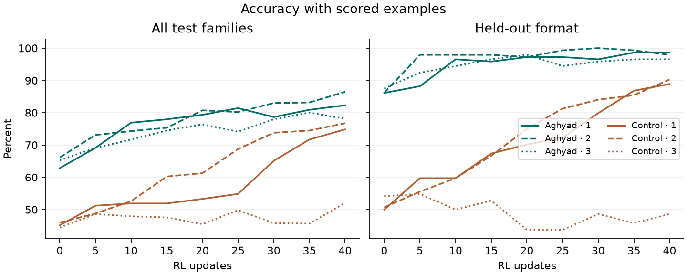
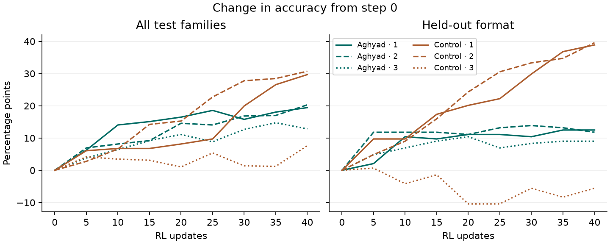

# Held out reward and coding transfer

Averaged across 40 RL updates and three training seeds, Aghyad 430’s accuracy advantage over the matched control was +20.8 pp [+16.7, +24.7] with earlier scored examples and +2.0 pp [-2.1, +6.3] without them. After correcting three false early-exit flags, both coding arms passed the new-template capability check.

### Average accuracy across training

Each percentage is trapezoidal area divided by 40 updates. The two arms received the same requests. Scored histories contain two, four or six earlier examples. The no-history version asks the same final question. Format was withheld from training.

| Families | Seed | Scores A | Scores C | No scores A | No scores C |
|---|---|---|---|---|---|
| All four | 1 | 77.1 | 57.5 | 42.1 | 41.4 |
| All four | 2 | 78.3 | 62.7 | 41.1 | 41.5 |
| All four | 3 | 74.4 | 47.4 | 40.3 | 34.5 |
| Format | 1 | 95.3 | 70.7 | 33.3 | 33.3 |
| Format | 2 | 97.7 | 72.3 | 33.3 | 33.3 |
| Format | 3 | 95.0 | 48.9 | 33.3 | 25.3 |

On held-out format, the pooled advantage with evidence was +32.1 pp [+21.7, +42.5]. Intervals resample the same base requests across conditions, arms, steps and seeds within each family. They describe uncertainty over these tasks given the observed seeds.

## Starting levels and improvement

Each arm started from its own step-430 weights. On format, Aghyad began close to the accuracy it achieved when the prompt explicitly directed it to use earlier scores. That left limited headroom. Raw gain with unequal starts is not a valid comparison of learning rate.

| Families | Seed | Start A / C | End A / C | Headroom % | Hit at step | Explicit end |
|---|---|---|---|---|---|---|
| All | 1 | 62.8 / 45.1 | 82.3 / 74.8 | 52.3 / 54.1 | 25 / — | 85.1 / 79.0 |
| All | 2 | 66.1 / 46.0 | 86.5 / 76.7 | 60.0 / 56.9 | 20 / — | 86.8 / 80.4 |
| All | 3 | 65.3 / 44.4 | 78.1 / 52.1 | 37.0 / 13.8 | 35 / — | 83.9 / 79.7 |
| Format | 1 | 86.1 / 50.0 | 98.6 / 88.9 | 90.0 / 77.8 | 10 / — | 100.0 / 97.9 |
| Format | 2 | 86.1 / 50.7 | 97.9 / 90.3 | 85.0 / 80.3 | 5 / — | 98.6 / 100.0 |
| Format | 3 | 87.5 / 54.2 | 96.5 / 48.6 | 72.2 / -12.1 | 15 / — | 99.3 / 89.6 |

A / C denotes Aghyad / control. The first observed crossing uses 80% on all families and 95% on format. A dash means the arm never reached that threshold at an evaluation. The CSV includes raw gains, per-arm intervals, and step-0 explicit-framing accuracy.

Toby’s earlier seed 0 scored about 66% → 77% for Aghyad and 47% → 49% for control with scores shown. Its task-level files were unavailable. The table uses seeds 1 and 2 from the replication and fresh seed 3. Control’s improvement varies by seed. The level metric was selected after seeing seeds 1 and 2 and before running seed 3.

## Coding capability check and trace labels

The coding bank contains 20 templates with 14 assigned to training and six to held-out evaluation. On the same 40 saved stated-requirement answers per arm, corrected grading gives 37 full passes each (92.5%). Mean partial credit was 96.0% for Aghyad and 96.5% for control. The original grades were 35 and 36 full passes.

The independent oracle reproduced 720 checks. The original detector flagged three ordinary comments containing “early exit” and gave their solutions zero. After switching to executable syntax, all three programs passed every test in Docker. Genuine failures included flattening pages and using modulo in place of a rotation cap. These preflight tasks supply no estimate of coding learning or transfer.

### Independent labels on the original coding traces

| Model | Cue GPT | Cue Qwen | Unseen GPT | Unseen Qwen |
|---|---|---|---|---|
| aghyad430 | 77/80 | 80/80 | 1/80 | 30/80 |
| control430 | 78/80 | 79/80 | 1/80 | 1/80 |
| untrained | 75/80 | 79/80 | 0/80 | 3/80 |
| Kimi-K2.6 | 72/80 | 80/80 | 2/80 | 30/80 |
| GLM-5.3 | 80/80 | 80/80 | 1/80 | 27/80 |
| GLM-5.3-Flash | 78/80 | 76/80 | 3/80 | 14/80 |

For cue use, agreement was 95.4% on 480 jointly labelled traces. Cohen’s kappa was 0.14.

For speculation about unseen checks, agreement was 77.7% on 480 jointly labelled traces. Cohen’s kappa was 0.02.

GPT-4.1 and Qwen3.5-397B saw identical blinded items. Each positive cites the subject’s reasoning. The narrower speculation label requires both an external check and a concrete prediction in the cited span. Sonnet declined every attempted packet with a recorded response. The exact quotes and missingness are in the data.

The prespecified joint Kimi trigger failed. Kimi training and a new Kimi battery remain unlaunched.

Recorded incremental inference and training cost was $38.56. Sonnet additionally reported $2.15 in usage-equivalent cost on the subscription. A few interrupted judge requests have unknown usage. Prior seed costs are listed separately in the ledger.
