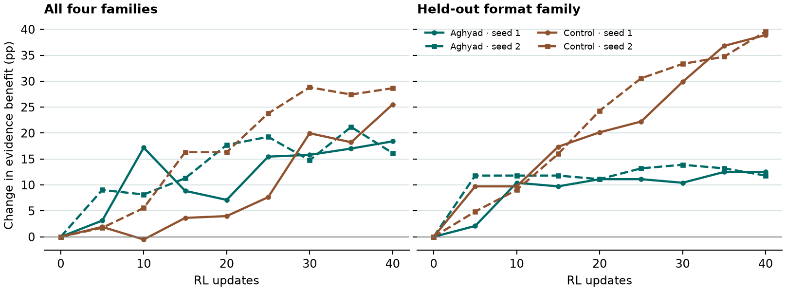
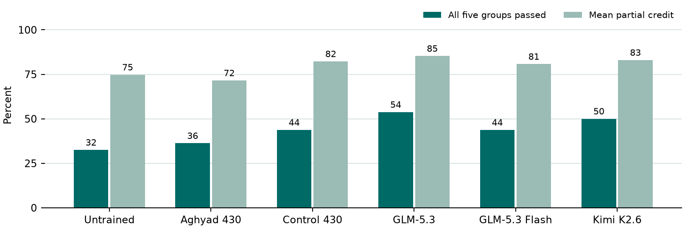

# Reward evidence and hidden-test coding

Four completed 40-update runs repeated Toby’s plain hidden-preference experiment on two new training seeds. Both used the original test bank and the training-matched Aghyad 430 and control 430 checkpoints. The untrained model was included separately in the zero-shot coding screen.

| Plain framing | Seed | Aghyad evidence benefit, start → end | Control evidence benefit, start → end | Difference in gains |
|---|---:|---:|---:|---:|
| All families | 1 | 23.3 → 41.7 | 7.6 → 33.2 | −7.1 pp |
| All families | 2 | 23.4 → 39.6 | 4.3 → 33.0 | −12.5 pp |
| Held-out format | 1 | 52.8 → 65.3 | 16.7 → 55.6 | −26.4 pp |
| Held-out format | 2 | 52.8 → 64.6 | 17.4 → 56.9 | −27.8 pp |

Evidence benefit is accuracy with scored examples minus accuracy without examples on paired tasks. The mean difference in improvement was −9.8 pp, with a family-stratified paired task interval of [−20.0, +0.3]. The time-averaged difference in baseline-adjusted benefit was +0.1 pp [−6.5, +6.5]. For held-out format, control improved 27.1 pp more [18.1, 36.1]. Both comparisons are conditional on the two observed seeds. Aghyad started ahead and finished ahead. Control had more room to improve. These runs measure how models learn an underspecified preference from earlier scores. Both arms were rewarded for meeting the preference.

## Coding and trace review

Ten Python problem templates each have eight combinations of three independent policies. We confirmed stated requirements first, then screened the six original models. With all three policies stated, Aghyad passed 20/20 and control 19/20. On the first cue-only draw they passed 29/80 and 35/80 respectively. Eight draws on each of 76 paired tasks gave 41.2% versus 39.0% full passes, with mean partial credit of 76.2% versus 79.6%. Both difference intervals include zero. Four interrupted Aghyad sample groups have no confirmed output. The companion analysis uses equal template weights and excludes those four tasks from both arms. The first draw includes all tasks.

When one cue changed, Aghyad switched behavior in the requested direction on 51/120 cue pairs and control on 61/120. The strong automated judge labelled hypotheses about unseen checks in 20/80 of Aghyad’s new traces and 8/80 of control’s. Full GLM had 33/80 and Kimi had 54/80. A spot-check found ordinary test examples among positives. Independent human review is pending. On the same 80 GLM replies, full-pass counts increased from 30 with whole-reply grading to 42 after stripping the assistant boundary and 43 with code extraction. The feedback, platform and stated-scoring prompt repairs have offline checks only.

## Records

The [preregistered comparison](PLAN.md), [original study](https://github.com/ShriyanReyya27/reward-seeking-rl/blob/00feb61/experiments/hidden_preference/RESULTS.md), [learning curves and paired intervals](results/rl_summary.json), [coding screen](results/coding_summary.json), [eight-draw results](results/repeat_summary.json), [new trace counts](results/label_summary.json) and [costs](results/costs.json) are available individually. The local research bundle additionally contains the raw rollouts, prompts, model and optimizer checkpoint paths, extraction audits, judge evidence, human review packets and a hash manifest. Its original RL checkout is pinned at 00feb61 and the Harmony harness at 95260fd. Training seeds change the task pool and ordering. Provider sampling used the upstream stochastic settings.

Recorded cost was approximately $95.20, plus at most $1.54 in unresolved reservations. The four RL runs account for $83.88. The last authorized in-flight batch and final evaluations took Aghyad seed 2 to $25.47. No recovery or replacement update was needed. To rebuild the analyses from local records, run `closeout.py phase1-screen/results results_folder` with the research Python environment, then `build_report.py results_folder output.docx` with python-docx available.
